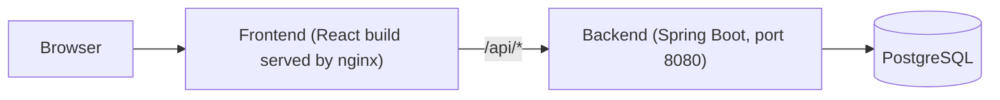
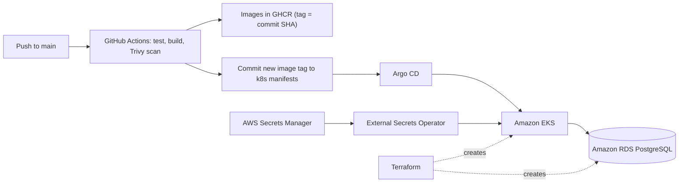

# TaskFlow

A full-stack task manager (React + Spring Boot + PostgreSQL) with a complete cloud-native delivery pipeline: Docker, GitHub Actions, Terraform, Amazon EKS, Argo CD (GitOps), External Secrets, and Prometheus/Grafana.

- **Just want to run it?** Go to [Quick start](#quick-start-docker-compose). You only need Docker.
- **Want to hack on the code?** See [Local development without Docker](#local-development-without-docker).
- **Want to deploy it to AWS?** Read [Deploy to AWS](#deploy-to-aws), including the cost warning, first.

> **AWS cost warning:** the production setup creates billable resources (EKS control plane, 2 EC2 nodes, 2 NAT gateways, an Application Load Balancer, RDS, EBS volumes, Route 53). Running the local setup costs nothing.

## Table of contents

1. [Features](#features)
2. [Architecture](#architecture)
3. [Tech stack](#tech-stack)
4. [Repository structure](#repository-structure)
5. [Quick start (Docker Compose)](#quick-start-docker-compose)
6. [Local development without Docker](#local-development-without-docker)
7. [API reference](#api-reference)
8. [Configuration](#configuration)
9. [Testing](#testing)
10. [Deploy to AWS](#deploy-to-aws)
11. [CI/CD and GitOps](#cicd-and-gitops)
12. [Operations](#operations)
13. [Backup and recovery](#backup-and-recovery)
14. [Destroying the environment](#destroying-the-environment)
15. [Troubleshooting](#troubleshooting)
16. [Known limitations](#known-limitations)

## Features

- Create, view, edit and delete tasks (todos) with a title, description, priority (`LOW`, `MEDIUM`, `HIGH`) and status (`PENDING`, `IN_PROGRESS`, `COMPLETED`).
- Dashboard with summary cards and a task list/modal editor.
- REST API with request validation and a global error handler.
- Health and Prometheus metrics endpoints (Spring Boot Actuator).
- Backend unit, controller, validation and integration tests (H2 in-memory database).

## Architecture

**Runtime**



The browser only talks to the frontend container. nginx serves the React app and proxies `/api/*` to the backend, so no CORS setup is needed in the containerized setup.

**Delivery (production)**



## Tech stack

| Area | Technology (version from this repo) |
|---|---|
| Frontend | React 19, Vite 8, React Router 7, Axios, served by nginx |
| Backend | Java 25, Spring Boot 4.1.1, Spring Data JPA, Bean Validation, Lombok, Maven Wrapper |
| Database | PostgreSQL 16 (local Compose), PostgreSQL 17 (RDS, `db.t4g.micro`) |
| Containers | Docker, Docker Compose |
| Infrastructure as code | Terraform >= 1.16 (AWS provider ~> 6.0, Helm ~> 3.0, Kubernetes ~> 3.0) |
| Cloud | AWS (`ap-south-1`): VPC, EKS (Kubernetes 1.37), RDS, Route 53, ACM, Secrets Manager |
| CI/CD | GitHub Actions, GitHub Container Registry (GHCR), Trivy |
| GitOps | Argo CD |
| Ingress | Kubernetes Gateway API with the AWS Load Balancer Controller (ALB) |
| Secrets | AWS Secrets Manager + External Secrets Operator |
| Observability | kube-prometheus-stack (Prometheus, Grafana, Alertmanager), Discord alerts |
| Load testing | k6 |

## Repository structure

```text
.
├── backend/                     # Spring Boot API (Maven, Dockerfile, tests)
│   └── src/main/java/com/taskflow/taskflow/
│       ├── controller/ service/ repository/ entity/ dto/ exception/ config/
├── frontend/                    # React app (Vite), Dockerfile, nginx config
├── docker-compose.yml           # Local stack: postgres + backend + frontend
├── k8s/
│   ├── applications/            # taskflow, argocd, observability manifests
│   └── infrastructure/          # gateway, secret stores, storage class, namespaces
├── argocd/taskflow.yaml         # Root Argo CD Application (bootstrap)
├── observability/values.yaml    # Helm values for kube-prometheus-stack
├── terraform/
│   ├── environments/production/ # Terraform root module
│   └── modules/                 # vpc, eks, rds, eks-controller, argocd,
│                                #   external-secrets, route53, acm
├── scripts/                     # rds-manual-backup.sh, obs-forward.sh
├── tests/load/                  # k6 load tests
└── .github/workflows/taskflow.yaml   # CI/CD pipeline
```

## Quick start (Docker Compose)

The fastest way to run everything locally. No Java, Node, or database install needed.

**You need:** [Git](https://git-scm.com/downloads) and [Docker](https://docs.docker.com/get-docker/) with Compose v2.

```bash
git --version
docker --version
docker compose version
```

**1. Clone**

```bash
git clone https://github.com/ZahaanMahajan/taskflow.git
cd taskflow
```

**2. Start**

```bash
docker compose up --build -d
```

The first build takes a few minutes (it downloads Maven and npm dependencies). Check that all three containers are up; the backend may take a short while after PostgreSQL becomes healthy:

```bash
docker compose ps
```

**3. Open**

| What | URL |
|---|---|
| App | http://localhost:3000 |
| API | http://localhost:8080/api/todos |
| Health check | http://localhost:8080/actuator/health |

The database tables are created automatically on first start (`ddl-auto: update`).

**4. Stop**

```bash
docker compose down        # stop, keep your data
docker compose down -v     # stop and DELETE the database volume
```

Local Compose credentials (database `taskflow`, user `taskflow`, password `taskflow`) are for local use only.

> **Required fix to `docker-compose.yml`:** the frontend's nginx config (`frontend/nginx/default.conf`) proxies to the hostname `taskflow-backend`, which is the Kubernetes service name. In Compose the backend service is called `backend`, so nginx cannot resolve it. Add a network alias to the `backend` service:
>
> ```yaml
>   backend:
>     # ...existing settings...
>     networks:
>       default:
>         aliases:
>           - taskflow-backend
> ```

## Local development without Docker

Use this when you want hot reload and a debugger.

**You need:** JDK 25 (e.g. [Temurin 25](https://adoptium.net/)), Node.js 22, and a PostgreSQL database. Maven is not required (the repo ships the Maven Wrapper).

**1. Start PostgreSQL** (matches the `dev` profile: database `taskflow`, user `postgres`, password `postgres`):

```bash
docker run --name taskflow-db -d -p 5432:5432 \
  -e POSTGRES_DB=taskflow -e POSTGRES_USER=postgres -e POSTGRES_PASSWORD=postgres \
  postgres:16-alpine
```

**2. Start the backend** (port 8080):

```bash
cd backend
SPRING_PROFILES_ACTIVE=dev ./mvnw spring-boot:run
```

On Windows PowerShell: `$env:SPRING_PROFILES_ACTIVE="dev"; .\mvnw.cmd spring-boot:run`

**3. Start the frontend** (new terminal):

```bash
cd frontend
npm ci
npm run dev
```

Open http://localhost:5173. The Vite dev server proxies `/api` to `http://localhost:8080` (see `frontend/vite.config.js`).

## API reference

Base path: `/api/todos`

| Method | Path | Description |
|---|---|---|
| `GET` | `/api/todos` | List all todos |
| `GET` | `/api/todos/{id}` | Get one todo (error if it does not exist) |
| `POST` | `/api/todos` | Create a todo |
| `PUT` | `/api/todos/{id}` | Replace a todo's fields |
| `DELETE` | `/api/todos/{id}` | Delete a todo |

**Request body** (`POST` and `PUT`):

```json
{
  "title": "Write README",
  "description": "Make it easy to install",
  "priority": "HIGH",
  "status": "PENDING"
}
```

`title` is required and must not be blank. `priority` is `LOW` | `MEDIUM` | `HIGH`. `status` is `PENDING` | `IN_PROGRESS` | `COMPLETED`.

**Try it:**

```bash
curl -X POST http://localhost:8080/api/todos \
  -H "Content-Type: application/json" \
  -d '{"title":"First task","priority":"MEDIUM","status":"PENDING"}'

curl http://localhost:8080/api/todos
```

**Operational endpoints:** `/actuator/health` (including liveness and readiness probes) and `/actuator/prometheus`.

## Configuration

The backend reads these environment variables:

| Variable | Used by | Description | Default |
|---|---|---|---|
| `SPRING_PROFILES_ACTIVE` | all | `dev`, `prod`, or `test` | none |
| `DB_URL` | `prod` | JDBC URL, e.g. `jdbc:postgresql://postgres:5432/taskflow` | required |
| `DB_USER` | `prod` | Database user | required |
| `DB_PASSWORD` | `prod` | Database password | required |
| `CORS_ALLOWED_ORIGINS` | all | Comma-separated allowed origins for `/api/**` | `http://localhost:5173`, `http://localhost:3000`, `https://taskflow.aws.zahaan.online` |

| Profile | Database | Notes |
|---|---|---|
| `dev` | PostgreSQL at `localhost:5432/taskflow` (`postgres`/`postgres`) | SQL logging on |
| `prod` | From `DB_URL`, `DB_USER`, `DB_PASSWORD` | Used by Docker Compose and Kubernetes |
| `test` | H2 in memory | Used by the test suite |

Never commit real credentials. The `.gitignore` already excludes `.env*` and Terraform state/variable files.

## Testing

**Backend** (needs JDK 25; no database required, tests use H2):

```bash
cd backend
./mvnw clean test
```

**Frontend:**

```bash
cd frontend
npm ci
npm run build     # this is what CI runs
npm run lint
```

> `npm run lint` currently reports 2 errors (`react-hooks/set-state-in-effect` in `src/pages/Dashboard.jsx` and `src/components/TodoModal.jsx`). CI does not run lint, so the build passes.

**Load tests** ([k6](https://k6.io/docs/get-started/installation/) required). `taskflow-read.js` only reads; `taskflow.js` also creates todos, so do not point it at data you care about:

```bash
k6 run -e BASE_URL=http://localhost:3000 tests/load/taskflow-read.js
k6 run -e BASE_URL=http://localhost:3000 tests/load/taskflow.js
```

Without `BASE_URL`, the tests target `https://taskflow.aws.zahaan.online`.

## Deploy to AWS

This section is for operators who accept the costs above. Plan for a few hours on a first attempt. The repository is wired to the author's account and domain, so a fork must change the values below first.

### What gets created

Terraform (`terraform/environments/production`) creates: a VPC with 2 public and 2 private subnets and 2 NAT gateways, an EKS cluster `taskflow-production` (2 to 3 `c7i-flex.large` nodes), RDS PostgreSQL 17 `taskflow-production-db` (private, encrypted, deletion-protected), the AWS Load Balancer Controller, Argo CD, External Secrets Operator, a Route 53 zone, an ACM wildcard certificate, and empty AWS Secrets Manager secrets. Argo CD then deploys everything under `k8s/`.

### Prerequisites

- An AWS account and a non-root IAM identity allowed to create the resources above
- [AWS CLI](https://docs.aws.amazon.com/cli/latest/userguide/getting-started-install.html), [Terraform](https://developer.hashicorp.com/terraform/install) >= 1.16, [kubectl](https://kubernetes.io/docs/tasks/tools/), and [Helm](https://helm.sh/docs/intro/install/)
- A domain you control and can delegate a subdomain from
- A GitHub repository (fork) with GitHub Actions enabled

```bash
aws --version && terraform version && kubectl version --client && helm version
export AWS_PROFILE=taskflow          # your configured profile
export AWS_REGION=ap-south-1
aws sts get-caller-identity          # confirm this is the intended account
```

### Step 0: Replace the hardcoded values

Search and replace before the first `terraform apply`:

| What | Where | Change to |
|---|---|---|
| Terraform state bucket | `terraform/environments/production/versions.tf` | a bucket you own |
| EKS API allowed IP (`49.36.203.4/32`) | `terraform/modules/eks/main.tf` (`public_access_cidrs`) | your public IP as `x.x.x.x/32`, otherwise `kubectl` and the Helm provider cannot reach the cluster |
| Domain `aws.zahaan.online` | `terraform/environments/production/main.tf` (route53, acm), `k8s/infrastructure/gateway/gateway.yaml`, `k8s/applications/taskflow/gateway/httproute.yaml`, `k8s/applications/argocd/httproute.yaml`, optionally the `CORS_ALLOWED_ORIGINS` default in `application.properties` and the k6 default URL | your subdomain |
| ACM certificate ARN (contains the author's AWS account ID) | `k8s/infrastructure/gateway/loadbalancerconfiguration.yaml` | your certificate ARN, available after the first apply |
| ALB DNS name | `alb_dns_name` in `terraform/environments/production/main.tf` | your ALB's DNS name, available after the Gateway is created (see Step 6) |
| Image names `ghcr.io/zahaanmahajan/...` | `.github/workflows/taskflow.yaml`, both `deployment.yaml` files under `k8s/applications/taskflow/` | your GitHub user or org, in lowercase |
| Git repo URL `git@github.com:zahaanmahajan/taskflow.git` | `argocd/taskflow.yaml`, `k8s/applications/observability/application.yaml` | your repository |

### Step 1: Create the Terraform state bucket

The bucket must exist before `terraform init`. Terraform does not create it.

```bash
aws s3api create-bucket --bucket <YOUR_STATE_BUCKET> --region ap-south-1 \
  --create-bucket-configuration LocationConstraint=ap-south-1
aws s3api put-bucket-versioning --bucket <YOUR_STATE_BUCKET> \
  --versioning-configuration Status=Enabled
```

### Step 2: Apply Terraform

Provide the database password without writing it to disk or shell history:

```bash
read -rsp "Database password: " TF_VAR_database_password; echo
export TF_VAR_database_password
```

```bash
terraform -chdir=terraform/environments/production init
terraform -chdir=terraform/environments/production validate
terraform -chdir=terraform/environments/production plan
terraform -chdir=terraform/environments/production apply
```

Read the whole plan before approving. The Helm and Kubernetes providers connect to the cluster that this same configuration creates. If the first apply fails on Helm or Kubernetes resources, create the network and cluster first with `apply -target=module.vpc -target=module.eks`, then run a normal `apply`.

Afterwards, connect `kubectl` and note the outputs:

```bash
aws eks update-kubeconfig --name taskflow-production --region ap-south-1
terraform -chdir=terraform/environments/production output
```

### Step 3: Delegate DNS and validate the certificate

- Create NS records at your DNS provider that point your subdomain at the `route53_name_servers` output.
- The ACM certificate uses DNS validation, and the repo does not create the validation record. Add the CNAME shown in the ACM console to the Route 53 zone, and wait until the certificate is `Issued`.

### Step 4: Fill in the secrets

Terraform creates four **empty** secrets in AWS Secrets Manager. You must set their values. Create the JSON files outside the repository, upload them, then delete them.

| Secret ID | JSON content |
|---|---|
| `taskflow/production/database` | `{"DB_URL":"jdbc:postgresql://<rds_endpoint>:5432/taskflow","DB_USER":"taskflow","DB_PASSWORD":"<same as TF_VAR_database_password>"}` |
| `taskflow/production/ghcr` | `{"dockerconfigjson":"<Docker config JSON string for ghcr.io>"}` |
| `taskflow/production/argocd-github` | `{"type":"git","url":"git@github.com:<you>/taskflow.git","sshPrivateKey":"<private key>"}` |
| `taskflow/production/grafana` | `{"username":"admin","password":"<choose one>"}` |

```bash
aws secretsmanager put-secret-value --region ap-south-1 \
  --secret-id taskflow/production/database \
  --secret-string file://database.json
```

Notes:

- `rds_endpoint` comes from `terraform output rds_endpoint`.
- The GHCR value is a Docker config JSON containing a GitHub personal access token with `read:packages`. One way to generate it:
  `kubectl create secret docker-registry tmp --docker-server=ghcr.io --docker-username=<user> --docker-password=<PAT> --dry-run=client -o jsonpath='{.data.\.dockerconfigjson}' | base64 -d`
- For `argocd-github`, add the matching public key as a read-only **Deploy key** in your GitHub repository.

### Step 5: Create the Discord webhook secret (manual)

Alertmanager is configured to send alerts to Discord and expects a Kubernetes Secret named `alertmanager-discord-webhook` with the key `webhook-url`. It is not defined anywhere in this repository. Create it once the `observability` namespace exists (Argo CD creates it in Step 6):

```bash
read -rsp "Discord webhook URL: " WEBHOOK; echo
kubectl create secret generic alertmanager-discord-webhook \
  -n observability --from-literal=webhook-url="$WEBHOOK"
unset WEBHOOK
```

If you do not want Discord alerts, remove the `discord` receiver and routes from `observability/values.yaml`.

### Step 6: Bootstrap Argo CD

Argo CD needs the repository credential before it can read the repository, and that credential is itself defined inside the repository. Apply the two bootstrap resources by hand once, then apply the root application:

```bash
kubectl apply -f k8s/infrastructure/secrets/clustersecretstore.yaml
kubectl apply -f k8s/applications/argocd/externalsecret-github-repo.yaml
kubectl apply -f argocd/taskflow.yaml
```

Argo CD then syncs everything under `k8s/` (recursively), including the application, gateway, secret stores, and the monitoring stack, with automated prune and self-heal.

After the Gateway has created its Application Load Balancer, put the ALB's DNS name into `alb_dns_name` (Step 0) and run `terraform apply` again so that Route 53 points `taskflow.<domain>` and `argocd.<domain>` at it:

```bash
kubectl get gateway -n taskflow
```

### Step 7: Verify

```bash
kubectl get applications -n argocd            # Synced / Healthy
kubectl get externalsecrets -A                # SecretSynced
kubectl get pods -n taskflow                  # backend and frontend Running
kubectl rollout status deployment/taskflow-backend -n taskflow
```

Then open `https://taskflow.<your-domain>`.

### Gaps to be aware of

These are not installed or configured by anything in this repository. Verify them for your cluster:

- **Gateway API CRDs and controller settings:** the repo installs the AWS Load Balancer Controller via Helm but not the Gateway API CRDs. Check the controller's documentation for what your chart version needs to reconcile `Gateway` resources with `gatewayClassName: aws-alb`.
- **metrics-server:** the backend autoscaler (HPA) needs the Kubernetes Metrics API, and `kubectl top` depends on it. Nothing here installs it.

## CI/CD and GitOps

Pipeline: `.github/workflows/taskflow.yaml`. It runs on manual dispatch and on pushes to `main` that change `backend/**`, `frontend/**`, or the workflow file.

| Stage | What happens |
|---|---|
| Detect changes | Determines whether backend and/or frontend changed |
| Backend CI | JDK 25, `./mvnw clean test` |
| Frontend CI | Node 22, `npm ci`, `npm run build` |
| Image build and scan | Builds the Docker image, runs Trivy (fails on fixable HIGH or CRITICAL findings), then pushes to GHCR |
| Update GitOps | Writes the new image tag into the matching `deployment.yaml` and commits `chore: deploy TaskFlow <sha>` to `main` |
| Deploy | Argo CD detects the commit and syncs the cluster |

Images are tagged with the full commit SHA:

```text
ghcr.io/zahaanmahajan/taskflow-backend:<commit-sha>
ghcr.io/zahaanmahajan/taskflow-frontend:<commit-sha>
```

For the pipeline to work in your fork:

- Allow workflow write access to the repo (Settings > Actions > General > Workflow permissions), and ensure any branch protection on `main` lets `github-actions[bot]` push.
- GHCR packages are pushed with the built-in `GITHUB_TOKEN`; the cluster pulls them with the token you stored in `taskflow/production/ghcr`.

A successful image push does not prove a healthy rollout. Check Argo CD and `kubectl rollout status`.

**Rolling back:** `kubectl rollout undo` is reverted by Argo CD's self-heal. For a durable rollback, revert the `chore: deploy ...` commit in Git (or restore the previous image tag in the `deployment.yaml`) and let Argo CD sync.

## Operations

### Everyday checks

```bash
kubectl get pods,svc,hpa -n taskflow
kubectl logs deployment/taskflow-backend -n taskflow --tail=100
kubectl describe pod <POD_NAME> -n taskflow
kubectl get applications -n argocd
```

### Monitoring

Prometheus scrapes the backend's `/actuator/prometheus` through a `ServiceMonitor`. The stack includes a TaskFlow Grafana dashboard and these alerts, routed to Discord: backend target down, backend targets missing, high HTTP 5xx rate, high request latency, node-exporter down or missing.

Forward all three UIs from one terminal:

```bash
./scripts/obs-forward.sh start      # Grafana :3000, Alertmanager :9093, Prometheus :9090
./scripts/obs-forward.sh status
./scripts/obs-forward.sh stop
```

Port 3000 is also the local Compose frontend, so stop one before starting the other. Grafana's admin login is the `username` and `password` you stored in `taskflow/production/grafana`. Do not expose Grafana, Prometheus, Alertmanager, or Argo CD publicly without authentication.

### Autoscaling

Only the **backend** has a Horizontal Pod Autoscaler: 2 to 5 replicas at 60% average CPU (`k8s/applications/taskflow/backend/hpa.yaml`). The frontend runs a fixed 2 replicas.

## Backup and recovery

- **Automated RDS backups and point-in-time recovery are disabled** (`backup_retention_period = 0`). Manual snapshots are the only backup.
- Take a manual snapshot (needs AWS CLI credentials with RDS permissions):

  ```bash
  ./scripts/rds-manual-backup.sh
  ```

  It creates `taskflow-production-db-manual-<UTC timestamp>`, tags it, and waits until it is `available`.

- List snapshots:

  ```bash
  aws rds describe-db-snapshots --region ap-south-1 \
    --query 'DBSnapshots[].[DBSnapshotIdentifier,Status,SnapshotCreateTime,Encrypted]' --output table
  ```

- **Restore:** restoring a snapshot creates a **new** RDS instance and does not touch the original. Use the same DB subnet group and security group, keep it private, verify the `taskflow` database and `public.todos` table, then update `DB_URL` in the `taskflow/production/database` secret to switch the application over. External Secrets refreshes hourly, so restart the backend pods to pick it up sooner.
- Safeguards in place: storage encryption, deletion protection, and a required final snapshot named `taskflow-production-db-final-snapshot` when the instance is destroyed. That fixed name fails if a snapshot with the same name already exists; delete the old one or change the identifier first.

Disaster-recovery order of operations: confirm the Terraform state bucket and AWS access, restore RDS to a new instance, recover VPC/EKS/IAM through Terraform, recover External Secrets and Argo CD, let Argo CD sync from Git, point `DB_URL` at the restored database, verify the app and monitoring, and record what happened.

## Destroying the environment

Order matters, otherwise Terraform gets stuck on resources it did not create.

1. Delete the Argo CD applications (or the Gateway and HTTPRoutes) so the AWS Load Balancer Controller removes the ALB and its target groups. Without this, VPC deletion fails.
2. Delete the persistent volumes left by Prometheus and Grafana. The `gp3` StorageClass uses `reclaimPolicy: Retain`, so EBS volumes remain and keep billing until you delete them.
3. RDS has deletion protection enabled. To destroy it deliberately, disable it first, make sure the final-snapshot name is unused, and review the plan.
4. Run `terraform -chdir=terraform/environments/production destroy`, then delete manual snapshots and the state bucket if you no longer need them.

## Troubleshooting

| Symptom | Likely cause and fix |
|---|---|
| Compose: `frontend` exits or API calls fail with `host not found in upstream "taskflow-backend"` | Add the `taskflow-backend` network alias described in [Quick start](#quick-start-docker-compose) |
| Compose: backend restarts repeatedly | `docker compose logs --tail=100 backend`. Check the `DB_*` variables; inside Compose the DB host is `postgres`, not `localhost` |
| `./mvnw` fails with an unsupported class/release version | You are not on JDK 25. Run `java -version` |
| Port 3000, 5173, 8080 or 5432 already in use | Stop the other process, or change the host port in `docker-compose.yml` |
| Browser shows CORS errors in local dev | Use `http://localhost:5173` (proxied) or add your origin to `CORS_ALLOWED_ORIGINS` |
| `terraform init` fails on the backend | State bucket missing or no access. Check `aws sts get-caller-identity` and the bucket name. Never delete or recreate the bucket to "fix" it |
| `kubectl` or Terraform cannot reach the cluster | Your IP is not in the EKS `public_access_cidrs` |
| Terraform plan shows RDS, EKS or VPC replacement | Stop. Investigate before applying, as this can cause data loss or downtime |
| Pod `ImagePullBackOff` | Missing or expired GHCR token. `kubectl describe pod`, then check the `taskflow-ghcr` ExternalSecret and the `taskflow/production/ghcr` secret |
| Pod `CrashLoopBackOff` | `kubectl logs <pod> -n taskflow --previous`. Usually wrong `DB_URL` or password in the database secret |
| ExternalSecret not `SecretSynced` | `kubectl describe externalsecret -n <ns> <name>`. Secret value not set, wrong secret ID, or missing Pod Identity permissions |
| Argo CD not syncing | `kubectl describe application taskflow -n argocd`. Check repo URL, deploy key, and YAML validity |
| Alertmanager pod stuck | The `alertmanager-discord-webhook` secret is missing (Step 5) |
| HPA shows `<unknown>` | metrics-server is not installed |
| Backend cannot reach RDS | Check the RDS security group allows the EKS cluster security group on port 5432. Do not make RDS public |

## Known limitations

- **No authentication or authorization.** Anyone who can reach the API can read and change all todos.
- **No database migrations.** The schema is managed by Hibernate `ddl-auto: update`, including in `prod`.
- **Single-AZ database** (`multi_az = false`) on a small instance class, with no automated backups.
- Local Compose uses PostgreSQL 16 while RDS uses 17.
- Argo CD runs with `--insecure` (plain HTTP inside the cluster); TLS is terminated at the ALB.
- Several values (domain, account-specific ARN, IP allow-list, image names) are hardcoded to the original author's setup. See [Step 0](#step-0-replace-the-hardcoded-values).

Review this document whenever the Terraform modules, workflow, manifests, or secret mappings change.
