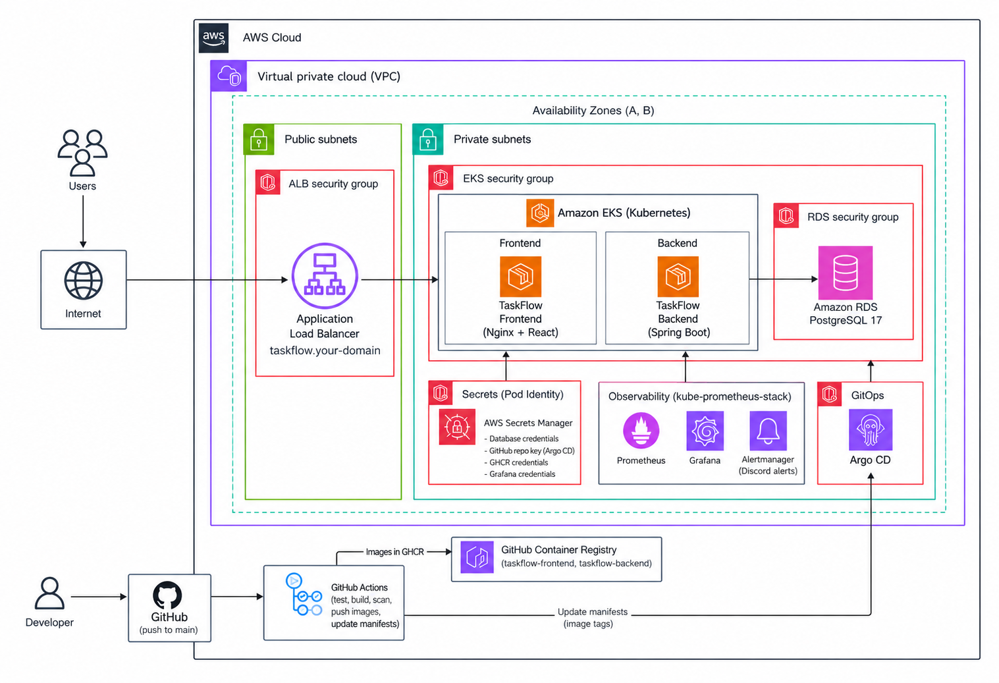
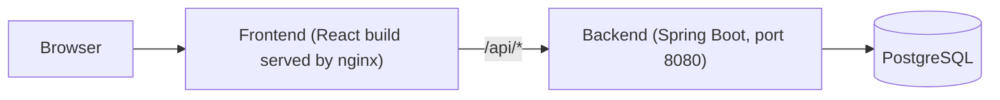
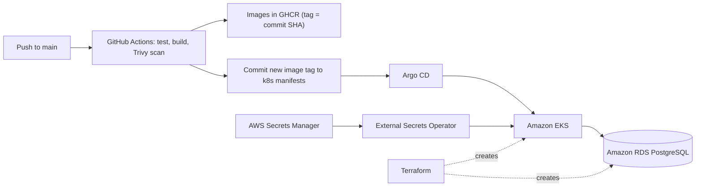

# TaskFlow

A full-stack task manager (React + Spring Boot + PostgreSQL) with a complete cloud-native delivery pipeline: Docker, GitHub Actions, Terraform, Amazon EKS, Argo CD (GitOps), External Secrets, and Prometheus/Grafana.

- **Just want to run it?** Go to [Quick start](#quick-start-docker-compose). You only need Docker.
- **Want to hack on the code?** See [Local development without Docker](#local-development-without-docker).
- **Want to deploy it to AWS?** Read [Deploy to AWS](#deploy-to-aws), including the cost warning, first.

> **AWS cost warning:** The AWS deployment creates billable resources, including the EKS control plane, EC2 worker nodes, NAT gateways, an Application Load Balancer, RDS, and potentially EBS volumes and retained snapshots. Local Docker Compose does not require these AWS resources.
>
> Set up an AWS Budget before deploying. When finished, follow [Destroying the environment](#destroying-the-environment) and verify that resources were actually removed. `terraform destroy` does not necessarily remove manually created resources, retained storage, or snapshots.
>
> **Data retention:** This project uses manual RDS snapshots. They remain in your account after the database is destroyed and may continue to incur storage charges. Keep a snapshot if you need the data; delete it only after confirming it is no longer required.

## Table of contents

1. [Features](#features)
2. [Architecture](#architecture)
3. [Tech stack](#tech-stack)
4. [Repository structure](#repository-structure)
5. [Quick start (Docker Compose)](#quick-start-docker-compose)
6. [Local development without Docker](#local-development-without-docker)
7. [API reference](#api-reference)
8. [Configuration](#configuration)
9. [Testing](#testing)
10. [Deploy to AWS](#deploy-to-aws)
11. [CI/CD and GitOps](#cicd-and-gitops)
12. [Operations](#operations)
13. [Backup and recovery](#backup-and-recovery)
14. [Destroying the environment](#destroying-the-environment)
15. [Troubleshooting](#troubleshooting)
16. [Known limitations](#known-limitations)

## Features

- Create, view, edit and delete tasks (todos) with a title, description, priority (`LOW`, `MEDIUM`, `HIGH`) and status (`PENDING`, `IN_PROGRESS`, `COMPLETED`).
- Dashboard with summary cards and a task list/modal editor.
- REST API with request validation and a global error handler.
- Health and Prometheus metrics endpoints (Spring Boot Actuator).
- Backend unit, controller, validation and integration tests (H2 in-memory database).

## Architecture

<p align="center">
  
</p>

**Runtime**



The browser only talks to the frontend container. nginx serves the React app and proxies `/api/*` to the backend, so no CORS setup is needed in the containerized setup.

**Delivery (production)**



## Tech stack

| Area | Technology (version from this repo) |
|---|---|
| Frontend | React 19, Vite 8, React Router 7, Axios, served by nginx |
| Backend | Java 25, Spring Boot 4.1.1, Spring Data JPA, Bean Validation, Lombok, Maven Wrapper |
| Database | PostgreSQL 16 (local Compose), PostgreSQL 17 (RDS, `db.t4g.micro`) |
| Containers | Docker, Docker Compose |
| Infrastructure as code | Terraform >= 1.16 (AWS provider ~> 6.0, Helm ~> 3.0, Kubernetes ~> 3.0) |
| Cloud | AWS (`ap-south-1`): VPC, EKS (Kubernetes 1.37), RDS, Route 53, ACM, Secrets Manager |
| CI/CD | GitHub Actions, GitHub Container Registry (GHCR), Trivy |
| GitOps | Argo CD |
| Ingress | Kubernetes Gateway API with the AWS Load Balancer Controller (ALB) |
| Secrets | AWS Secrets Manager + External Secrets Operator |
| Observability | kube-prometheus-stack (Prometheus, Grafana, Alertmanager), Discord alerts |
| Load testing | k6 |

## Repository structure

```text
.
├── backend/                     # Spring Boot API (Maven, Dockerfile, tests)
│   └── src/main/java/com/taskflow/taskflow/
│       ├── controller/ service/ repository/ entity/ dto/ exception/ config/
├── frontend/                    # React app (Vite), Dockerfile, nginx config
├── docker-compose.yml           # Local stack: postgres + backend + frontend
├── k8s/
│   ├── applications/            # taskflow, argocd, observability manifests
│   └── infrastructure/          # gateway, secret stores, storage class, namespaces
├── argocd/taskflow.yaml         # Root Argo CD Application (bootstrap)
├── observability/values.yaml    # Helm values for kube-prometheus-stack
├── terraform/
│   ├── environments/production/ # Terraform root module
│   └── modules/                 # vpc, eks, rds, eks-controller, argocd,
│                                #   external-secrets, route53, acm
├── scripts/                     # rds-manual-backup.sh, obs-forward.sh
├── tests/load/                  # k6 load tests
└── .github/workflows/taskflow.yaml   # CI/CD pipeline
```

## Quick start (Docker Compose)

The fastest way to run everything locally. No Java, Node, or database install needed.

**You need:** [Git](https://git-scm.com/downloads) and [Docker](https://docs.docker.com/get-docker/) with Compose v2.

```bash
git --version
docker --version
docker compose version
```

**1. Clone**

```bash
git clone https://github.com/ZahaanMahajan/taskflow.git
cd taskflow
```

**2. Start**

```bash
docker compose up --build -d
```

The first build takes a few minutes (it downloads Maven and npm dependencies). Check that all three containers are up; the backend may take a short while after PostgreSQL becomes healthy:

```bash
docker compose ps
```

**3. Open**

| What | URL |
|---|---|
| App | http://localhost:3000 |
| API | http://localhost:8080/api/todos |
| Health check | http://localhost:8080/actuator/health |

The database tables are created automatically on first start (`ddl-auto: update`).

**4. Stop**

```bash
docker compose down        # stop, keep your data
docker compose down -v     # stop and DELETE the database volume
```

Local Compose credentials (database `taskflow`, user `taskflow`, password `taskflow`) are for local use only.

> **Why the `taskflow-backend` alias exists:** the frontend's nginx config (`frontend/nginx/default.conf`) proxies to `taskflow-backend`, the Kubernetes service name. The `backend` service in `docker-compose.yml` declares a network alias with that name so the same frontend image works in Compose and in Kubernetes. No manual edit is needed.

## Local development without Docker

Use this when you want hot reload and a debugger.

**You need:** JDK 25 (e.g. [Temurin 25](https://adoptium.net/)), Node.js 22, and a PostgreSQL database. Maven is not required (the repo ships the Maven Wrapper).

**1. Start PostgreSQL** (matches the `dev` profile: database `taskflow`, user `postgres`, password `postgres`):

```bash
docker run --name taskflow-db -d -p 5432:5432 \
  -e POSTGRES_DB=taskflow -e POSTGRES_USER=postgres -e POSTGRES_PASSWORD=postgres \
  postgres:16-alpine
```

**2. Start the backend** (port 8080):

```bash
cd backend
SPRING_PROFILES_ACTIVE=dev ./mvnw spring-boot:run
```

On Windows PowerShell: `$env:SPRING_PROFILES_ACTIVE="dev"; .\mvnw.cmd spring-boot:run`

**3. Start the frontend** (new terminal):

```bash
cd frontend
npm ci
npm run dev
```

Open http://localhost:5173. The Vite dev server proxies `/api` to `http://localhost:8080` (see `frontend/vite.config.js`).

## API reference

Base path: `/api/todos`

| Method | Path | Description |
|---|---|---|
| `GET` | `/api/todos` | List all todos |
| `GET` | `/api/todos/{id}` | Get one todo (error if it does not exist) |
| `POST` | `/api/todos` | Create a todo |
| `PUT` | `/api/todos/{id}` | Replace a todo's fields |
| `DELETE` | `/api/todos/{id}` | Delete a todo |

**Request body** (`POST` and `PUT`):

```json
{
  "title": "Write README",
  "description": "Make it easy to install",
  "priority": "HIGH",
  "status": "PENDING"
}
```

`title` is required and must not be blank. `priority` is `LOW` | `MEDIUM` | `HIGH`. `status` is `PENDING` | `IN_PROGRESS` | `COMPLETED`.

**Try it:**

```bash
curl -X POST http://localhost:8080/api/todos \
  -H "Content-Type: application/json" \
  -d '{"title":"First task","priority":"MEDIUM","status":"PENDING"}'

curl http://localhost:8080/api/todos
```

**Operational endpoints:** `/actuator/health` (including liveness and readiness probes) and `/actuator/prometheus`.

## Configuration

The backend reads these environment variables:

| Variable | Used by | Description | Default |
|---|---|---|---|
| `SPRING_PROFILES_ACTIVE` | all | `dev`, `prod`, or `test` | none |
| `DB_URL` | `prod` | JDBC URL, e.g. `jdbc:postgresql://postgres:5432/taskflow` | required |
| `DB_USER` | `prod` | Database user | required |
| `DB_PASSWORD` | `prod` | Database password | required |
| `CORS_ALLOWED_ORIGINS` | all | Comma-separated allowed origins for `/api/**` | `http://localhost:5173`, `http://localhost:3000`, `https://taskflow.aws.zahaan.online` |

| Profile | Database | Notes |
|---|---|---|
| `dev` | PostgreSQL at `localhost:5432/taskflow` (`postgres`/`postgres`) | SQL logging on |
| `prod` | From `DB_URL`, `DB_USER`, `DB_PASSWORD` | Used by Docker Compose and Kubernetes |
| `test` | H2 in memory | Used by the test suite |

Never commit real credentials. The `.gitignore` already excludes `.env*` and Terraform state/variable files.

## Testing

**Backend** (needs JDK 25; no database required, tests use H2):

```bash
cd backend
./mvnw clean test
```

**Frontend:**

```bash
cd frontend
npm ci
npm run lint      # CI runs this
npm run build     # CI runs this
```

CI runs both `npm run lint` and `npm run build`, so run them locally before pushing.

**Load tests** ([k6](https://k6.io/docs/get-started/installation/) required). `taskflow-read.js` only reads; `taskflow.js` also creates todos, so do not point it at data you care about:

```bash
k6 run -e BASE_URL=http://localhost:3000 tests/load/taskflow-read.js
k6 run -e BASE_URL=http://localhost:3000 tests/load/taskflow.js
```

Without `BASE_URL`, the tests target `https://taskflow.aws.zahaan.online`.

## Deploy to AWS

This section is for operators who accept the costs above. Plan for a few hours on a first attempt. The repository is wired to the author's account and domain, so a fork must change the values below first.

### What gets created

Terraform (`terraform/environments/production`) creates: a VPC with 2 public and 2 private subnets and 2 NAT gateways, an EKS cluster `taskflow-production` (2 to 3 `c7i-flex.large` nodes), RDS PostgreSQL 17 `taskflow-production-db` (private, encrypted, deletion-protected), the AWS Load Balancer Controller, Argo CD, External Secrets Operator, a Route 53 hosted zone, a request for an ACM wildcard certificate, and empty AWS Secrets Manager secrets. Argo CD then deploys everything under `k8s/`.

Two parts of the DNS setup are **not** automatic. Creating the Route 53 hosted zone does not delegate your domain to it: you must add NS records at your DNS provider. The ACM certificate is only issued after DNS validation succeeds, and you must add the validation record yourself. Both are covered in [Step 4](#step-4-delegate-dns-and-validate-the-certificate).

### Prerequisites

- An AWS account and a non-root IAM identity allowed to create the resources above
- [AWS CLI](https://docs.aws.amazon.com/cli/latest/userguide/getting-started-install.html), [Terraform](https://developer.hashicorp.com/terraform/install) >= 1.16, [kubectl](https://kubernetes.io/docs/tasks/tools/), and [Helm](https://helm.sh/docs/intro/install/)
- A domain you control and can delegate a subdomain from
- A GitHub repository (fork) with GitHub Actions enabled

```bash
aws --version && terraform version && kubectl version --client && helm version
export AWS_PROFILE=taskflow          # your configured profile
export AWS_REGION=ap-south-1
aws sts get-caller-identity          # confirm this is the intended account
```

### Step 0: Replace the hardcoded values

Before the first `terraform apply`, review every account-specific value. Do not copy the author's AWS identifiers, IP address, domain, or repository settings into your own deployment.

| Setting | Location | Required action |
|---|---|---|
| Terraform state bucket | `terraform/environments/production/versions.tf` | Create a globally unique S3 bucket that you own. Use the same bucket name in the backend configuration. |
| AWS region | Terraform configuration, manifests and commands | Choose a region and ensure all resources and commands use it consistently. This README uses `ap-south-1`. |
| EKS API allow-list | `terraform/modules/eks/main.tf` (`public_access_cidrs`) | Replace the example IP with your current public IP in CIDR notation, such as `x.x.x.x/32`. Restrict access to trusted addresses. Otherwise `kubectl` and the Helm provider cannot reach the cluster. |
| Domain and DNS zone | `terraform/environments/production/main.tf`, `k8s/infrastructure/gateway/gateway.yaml`, application `httproute.yaml` files | Replace `aws.zahaan.online` and related hostnames with a subdomain you control. Check every DNS, certificate and hostname reference. |
| ACM certificate ARN | `k8s/infrastructure/gateway/loadbalancerconfiguration.yaml` | Use the certificate ARN created in your AWS account, in the same region as the ALB. It is available after Step 2 (see Step 4). |
| ALB DNS name | `alb_dns_name` in `terraform/environments/production/main.tf` | Set this only after the Gateway has provisioned your ALB (see Step 8). Do not retain the author's ALB hostname. |
| Container image names | `.github/workflows/taskflow.yaml` and the frontend/backend `deployment.yaml` files | Replace `ghcr.io/zahaanmahajan/...` with your lowercase GitHub username or organization and the correct package names. |
| Git repository URLs | `argocd/taskflow.yaml`, `k8s/applications/observability/application.yaml`, and relevant secret values | Replace the author's repository URL with your own. Use a deploy key or other appropriately scoped credentials. |
| AWS credentials and profile | Local AWS CLI configuration | Configure your own IAM identity. Do not commit credentials, access keys, state files, or secret values. |

The domain also appears in the `CORS_ALLOWED_ORIGINS` default in `application.properties` and in the k6 default URL; update those too if you want them to match your deployment.

Search for remaining references before deploying:

```bash
grep -RInE 'zahaan\.online|zahaanmahajan|49\.36\.203\.4|372951851996' \
  terraform k8s argocd .github
```

Review each result. Replace values that belong to the original author's environment; do not blindly replace unrelated text.

After customization, commit and push the changes to your repository's `main` branch before bootstrapping Argo CD.

> **Important:** The `alb_dns_name` value is a deployment dependency, not a value you can know before the ALB exists. Keep it as is for now and update it after Step 8, as described there.

### Step 1: Create the Terraform state bucket

The bucket must exist before `terraform init`. Terraform does not create it, and the state it holds can contain sensitive infrastructure details, so lock it down. Bucket names are globally unique, so pick your own and use the same name in `versions.tf`.

```bash
BUCKET=<YOUR_STATE_BUCKET>

aws s3api create-bucket --bucket "$BUCKET" --region ap-south-1 \
  --create-bucket-configuration LocationConstraint=ap-south-1

aws s3api put-public-access-block --bucket "$BUCKET" \
  --public-access-block-configuration \
  BlockPublicAcls=true,IgnorePublicAcls=true,BlockPublicPolicy=true,RestrictPublicBuckets=true

aws s3api put-bucket-encryption --bucket "$BUCKET" \
  --server-side-encryption-configuration \
  '{"Rules":[{"ApplyServerSideEncryptionByDefault":{"SSEAlgorithm":"AES256"}}]}'

aws s3api put-bucket-versioning --bucket "$BUCKET" \
  --versioning-configuration Status=Enabled
```

Verify the setup, and check that it matches the `backend "s3"` block in `terraform/environments/production/versions.tf` (`bucket`, `key`, `region = "ap-south-1"`, `encrypt = true`, `use_lockfile = true`):

```bash
aws s3api get-public-access-block --bucket "$BUCKET"   # all four values true
aws s3api get-bucket-encryption   --bucket "$BUCKET"
aws s3api get-bucket-versioning   --bucket "$BUCKET"   # Status: Enabled
```

**State bucket lifecycle:** The S3 backend is created separately from the infrastructure managed by this Terraform root module. Destroying the environment does not necessarily delete the bucket. Keep it while you may need to inspect state, recover infrastructure, or recreate the environment. Do not delete the bucket just to resolve a Terraform error.

If you eventually decide to remove it, first confirm that the environment has been destroyed, no recovery is required, and the bucket contains no state you need. If versioning is enabled, deleting the current objects is not sufficient to remove previous object versions; account for those versions before deleting the bucket.

### Step 2: Apply Terraform

Provide the database password without writing it to disk or shell history:

```bash
read -rsp "Database password: " TF_VAR_database_password; echo
export TF_VAR_database_password
```

Run the normal sequence. This is the expected way to deploy:

```bash
terraform -chdir=terraform/environments/production init
terraform -chdir=terraform/environments/production validate
terraform -chdir=terraform/environments/production plan
terraform -chdir=terraform/environments/production apply
```

Read the whole plan before approving.

**If the apply fails**, read the error first. Two failures are expected on a brand-new account:

- **Helm or Kubernetes provider cannot connect.** These providers connect to the cluster that this same configuration creates. This is the one case where a targeted apply is a reasonable recovery path:

  ```bash
  # Recovery only: build the prerequisites first...
  terraform -chdir=terraform/environments/production apply \
    -target=module.vpc -target=module.eks
  # ...then immediately run the normal, untargeted apply again
  terraform -chdir=terraform/environments/production apply
  ```

  `-target` is an exceptional Terraform feature, not a way to deploy this environment. Terraform itself warns that it can leave state and configuration out of step. Always finish with a full untargeted `apply` so everything is reconciled.

- **The two Route 53 alias records fail.** `alb_dns_name` in `main.tf` points at the original author's load balancer, which does not exist in your account. Re-run after Step 8 puts in your own ALB's DNS name. Terraform still creates the independent resources; run `plan` afterwards to confirm nothing else is pending.

Afterwards, connect `kubectl` and note the outputs:

```bash
aws eks update-kubeconfig --name taskflow-production --region ap-south-1
terraform -chdir=terraform/environments/production output
kubectl get nodes
```

### Step 3: Install the Gateway API CRDs

Terraform installs the AWS Load Balancer Controller (Helm chart `3.6.0`, `terraform/modules/eks-controller/main.tf`) but **not** the Gateway API CRDs. Without them the controller does not reconcile `Gateway` and `HTTPRoute` resources, and no ALB is created.

**1. Confirm the controller version** that chart `3.6.0` ships:

```bash
helm repo add eks https://aws.github.io/eks-charts && helm repo update
helm show chart eks/aws-load-balancer-controller --version 3.6.0 | grep -E '^(version|appVersion):'
```

The `appVersion` should be `v3.6.0`. The manifests in this repo use `gateway.k8s.aws/v1` for `LoadBalancerConfiguration` and `TargetGroupConfiguration`, which needs controller v3.5.0 or newer. According to the controller's release notes, v3.6.0 is built against Gateway API CRDs v1.6.0.

**2. Install the two sets of CRDs**, pinned to those versions (use the `appVersion` printed above for `LBC_VERSION` if it differs):

```bash
export LBC_VERSION=v3.6.0

# Standard Gateway API CRDs (v1.6.0, the version the controller is built for)
kubectl apply --server-side=true -f \
  https://github.com/kubernetes-sigs/gateway-api/releases/download/v1.6.0/standard-install.yaml

# AWS-specific CRDs (LoadBalancerConfiguration, TargetGroupConfiguration, ListenerRuleConfiguration)
kubectl apply -f \
  "https://raw.githubusercontent.com/kubernetes-sigs/aws-load-balancer-controller/${LBC_VERSION}/config/crd/gateway/gateway-crds.yaml"
```

Do not use `refs/heads/main` URLs here. They track whatever is newest and may not match your controller. When you later bump the chart version, upgrade the CRDs first, then the controller.

**3. Restart the controller** so it detects the CRDs (the controller enables its ALB Gateway support when the CRDs are present; restarting is the safe way to guarantee it checks after they exist):

```bash
kubectl rollout restart deployment/aws-load-balancer-controller -n kube-system
kubectl rollout status  deployment/aws-load-balancer-controller -n kube-system
```

**4. Verify:**

```bash
kubectl get crd | grep -E 'gateway.networking.k8s.io|gateway.k8s.aws'
kubectl -n kube-system logs deploy/aws-load-balancer-controller | grep "gateway.k8s.aws/alb"
```

You should see the Gateway and HTTPRoute CRDs, the three `gateway.k8s.aws` CRDs, and log lines for the `gateway.k8s.aws/alb` controller. If the log line is missing, the controller started without the CRDs. Check the CRDs, then restart it again.

### Step 4: Delegate DNS and validate the certificate

- Create NS records at your DNS provider that point your subdomain at the `route53_name_servers` output.
- The ACM certificate uses DNS validation, and the repo does not create the validation record. Add the CNAME shown in the ACM console to the Route 53 zone, and wait until the certificate is `Issued`.
- Put the certificate's ARN into `k8s/infrastructure/gateway/loadbalancerconfiguration.yaml` (Step 0).

**Then commit and push every Step 0 change to the `main` branch of your repository.** Argo CD deploys what is in Git, not what is on your laptop.

### Step 5: Fill in the secrets

Terraform creates four **empty** secrets in AWS Secrets Manager. You must set their values. Create the JSON files **outside the repository**, upload them, then delete them.

| Secret ID | JSON content |
|---|---|
| `taskflow/production/database` | `{"DB_URL":"jdbc:postgresql://<rds_endpoint>:5432/taskflow","DB_USER":"taskflow","DB_PASSWORD":"<same as TF_VAR_database_password>"}` |
| `taskflow/production/ghcr` | `{"dockerconfigjson":"<Docker config JSON string for ghcr.io>"}` |
| `taskflow/production/argocd-github` | `{"type":"git","url":"git@github.com:<you>/taskflow.git","sshPrivateKey":"<private key>"}` |
| `taskflow/production/grafana` | `{"username":"admin","password":"<choose one>"}` |

```bash
aws secretsmanager put-secret-value --region ap-south-1 \
  --secret-id taskflow/production/database \
  --secret-string file://database.json
```

Notes:

- `rds_endpoint` comes from `terraform output rds_endpoint`.
- The GHCR value is a Docker config JSON containing a GitHub personal access token with `read:packages`. One way to generate it:
  `kubectl create secret docker-registry tmp --docker-server=ghcr.io --docker-username=<user> --docker-password=<PAT> --dry-run=client -o jsonpath='{.data.\.dockerconfigjson}' | base64 -d`
- For `argocd-github`, add the matching public key as a read-only **Deploy key** in your GitHub repository.

> **Keep credentials out of Git and out of your terminal history.**
> - Never create these JSON files inside the repository. If you must, add them to `.gitignore` first, and check `git status` before every commit.
> - Delete the files as soon as the upload succeeds (`shred -u database.json`, or `rm` on systems without `shred`).
> - Do not `cat` or `echo` secret values, and avoid typing them directly into commands. Use `read -rs` prompts or files.
> - If a secret is ever committed or pasted somewhere public, rotate it immediately. Deleting the commit is not enough.

### Step 6: Bootstrap Argo CD

Argo CD needs the repository credential before it can read the repository, and that credential is itself defined inside the repository. Apply the bootstrap resources by hand once, **checking each one is ready before moving on**, then apply the root application (run these from the repository root):

```bash
# 1. The secret store that lets External Secrets read AWS Secrets Manager
kubectl apply -f k8s/infrastructure/secrets/clustersecretstore.yaml
kubectl get clustersecretstore aws-secretsmanager          # wait until it reports Valid / Ready

# 2. The Argo CD repository credential (ExternalSecret "taskflow-github-repo")
kubectl apply -f k8s/applications/argocd/externalsecret-github-repo.yaml
kubectl wait --for=condition=Ready externalsecret/taskflow-github-repo -n argocd --timeout=180s

# 3. Confirm the resulting Secret exists and carries the Argo CD repository label
kubectl get secret taskflow-github-repo -n argocd --show-labels
#    expect the label: argocd.argoproj.io/secret-type=repository

# 4. Only now start the root application
kubectl apply -f argocd/taskflow.yaml
```

Do not print the Secret's contents. If step 2 times out, run `kubectl describe externalsecret taskflow-github-repo -n argocd`. The usual causes are an unset `taskflow/production/argocd-github` value (Step 5), a store that is not ready, or missing Pod Identity permissions for External Secrets. Fix that before step 4, otherwise the first sync fails with repository authentication errors.

Argo CD then syncs everything under `k8s/` (recursively), including the application, Gateway, secret stores, and the monitoring stack, with automated prune and self-heal. Check progress:

```bash
kubectl get applications -n argocd
```

### Step 7: Create the Discord webhook secret (manual)

Alertmanager sends alerts to Discord and expects a Kubernetes Secret named `alertmanager-discord-webhook` with the key `webhook-url`. It is not defined anywhere in this repository. The `observability` namespace is created by Argo CD in Step 6, so **wait until it exists**:

```bash
kubectl get namespace observability     # repeat until it exists
```

Then create the secret:

```bash
read -rsp "Discord webhook URL: " WEBHOOK; echo
kubectl create secret generic alertmanager-discord-webhook \
  -n observability \
  --from-literal=webhook-url="$WEBHOOK"
unset WEBHOOK
```

If you do not want Discord alerts, remove the `discord` receiver and routes from `observability/values.yaml` instead.

### Step 8: Wait for the ALB, then point DNS at it

The order matters: the Gateway API CRDs must exist (Step 3), the controller must be running with Gateway support, the Gateway must be accepted, and only then does an ALB exist whose DNS name you can use.

```bash
kubectl get gateway taskflow-gateway -n taskflow
kubectl describe gateway taskflow-gateway -n taskflow     # look for Accepted and Programmed = True
kubectl get gateway taskflow-gateway -n taskflow -o jsonpath='{.status.addresses[0].value}'; echo
```

The last command prints the ALB's DNS name. You can cross-check it with `aws elbv2 describe-load-balancers --region ap-south-1 --query 'LoadBalancers[].DNSName'`. If there is no address after several minutes, check `kubectl describe gateway`, the controller logs (`kubectl -n kube-system logs deploy/aws-load-balancer-controller`), and that Step 3 was completed before the controller was restarted.

Put that DNS name into `alb_dns_name` in `terraform/environments/production/main.tf`, then run the normal sequence again so Route 53 points `taskflow.<domain>` and `argocd.<domain>` at the ALB:

```bash
terraform -chdir=terraform/environments/production plan
terraform -chdir=terraform/environments/production apply
```

### Step 9: Verify

```bash
kubectl get applications -n argocd            # Synced / Healthy
kubectl get externalsecrets -A                # SecretSynced
kubectl get pods -n taskflow                  # backend and frontend Running
kubectl rollout status deployment/taskflow-backend -n taskflow
```

Then open `https://taskflow.<your-domain>`.

### Gap to be aware of

- **metrics-server:** the backend autoscaler (HPA) needs the Kubernetes Metrics API, and `kubectl top` depends on it. Nothing in this repository installs it, so install it yourself if you want autoscaling to work.

## CI/CD and GitOps

Pipeline: `.github/workflows/taskflow.yaml`. It runs on manual dispatch and on pushes to `main` that change `backend/**`, `frontend/**`, or the workflow file.

| Stage | What happens |
|---|---|
| Detect changes | Determines whether backend and/or frontend changed |
| Backend CI | JDK 25, `./mvnw clean test` |
| Frontend CI | Node 22, `npm ci`, `npm run lint`, `npm run build` |
| Image build and scan | Builds the Docker image, runs Trivy (fails on fixable HIGH or CRITICAL findings), then pushes to GHCR |
| Update GitOps | Writes the new image tag into the matching `deployment.yaml` and commits `chore: deploy TaskFlow <sha>` to `main` |
| Deploy | Argo CD detects the commit and syncs the cluster |

Images are tagged with the full commit SHA:

```text
ghcr.io/zahaanmahajan/taskflow-backend:<commit-sha>
ghcr.io/zahaanmahajan/taskflow-frontend:<commit-sha>
```

For the pipeline to work in your fork:

- Allow workflow write access to the repo (Settings > Actions > General > Workflow permissions), and ensure any branch protection on `main` lets `github-actions[bot]` push.
- GHCR packages are pushed with the built-in `GITHUB_TOKEN`; the cluster pulls them with the token you stored in `taskflow/production/ghcr`.

A successful image push does not prove a healthy rollout. Check Argo CD and `kubectl rollout status`.

**Rolling back:** `kubectl rollout undo` is reverted by Argo CD's self-heal. For a durable rollback, revert the `chore: deploy ...` commit in Git (or restore the previous image tag in the `deployment.yaml`) and let Argo CD sync.

## Operations

### Everyday checks

```bash
kubectl get pods,svc,hpa -n taskflow
kubectl logs deployment/taskflow-backend -n taskflow --tail=100
kubectl describe pod <POD_NAME> -n taskflow
kubectl get applications -n argocd
```

### Monitoring

Prometheus scrapes the backend's `/actuator/prometheus` through a `ServiceMonitor`. The stack includes a TaskFlow Grafana dashboard and these alerts, routed to Discord: backend target down, backend targets missing, high HTTP 5xx rate, high request latency, node-exporter down or missing.

Forward all three UIs from one terminal:

```bash
./scripts/obs-forward.sh start      # Grafana :3000, Alertmanager :9093, Prometheus :9090
./scripts/obs-forward.sh status
./scripts/obs-forward.sh stop
```

Port 3000 is also the local Compose frontend, so stop one before starting the other. Grafana's admin login is the `username` and `password` you stored in `taskflow/production/grafana`. Do not expose Grafana, Prometheus, Alertmanager, or Argo CD publicly without authentication.

### Autoscaling

Only the **backend** has a Horizontal Pod Autoscaler: 2 to 5 replicas at 60% average CPU (`k8s/applications/taskflow/backend/hpa.yaml`). The frontend has no HPA (`k8s/applications/taskflow/frontend/` contains none) and runs a fixed 2 replicas. `kubectl get hpa -n taskflow` should list a single autoscaler, `taskflow-backend`.

## Backup and recovery

- **Automated RDS backups and point-in-time recovery are disabled** (`backup_retention_period = 0`). Manual snapshots are the only backup.
- Take a manual snapshot (needs AWS CLI credentials with RDS permissions):

  ```bash
  ./scripts/rds-manual-backup.sh
  ```

  It creates `taskflow-production-db-manual-<UTC timestamp>`, tags it, and waits until it is `available`.

- List snapshots:

  ```bash
  aws rds describe-db-snapshots --region ap-south-1 \
    --query 'DBSnapshots[].[DBSnapshotIdentifier,Status,SnapshotCreateTime,Encrypted]' --output table
  ```

- **Restore:** restoring a snapshot creates a **new** RDS instance and does not touch the original. Use the same DB subnet group and security group, keep it private, verify the `taskflow` database and `public.todos` table, then update `DB_URL` in the `taskflow/production/database` secret to switch the application over. External Secrets refreshes hourly, so restart the backend pods to pick it up sooner.
- **Deletion protection and snapshots:** RDS storage is encrypted, and deletion protection is enabled during normal operation. Before destroying the database, deliberately disable deletion protection and verify that the final-snapshot identifier is available. Terraform is configured to create a final snapshot named `taskflow-production-db-final-snapshot`; a name collision can cause deletion to fail.
- **Manual snapshots are independent resources:** `scripts/rds-manual-backup.sh` creates snapshots named `taskflow-production-db-manual-<UTC timestamp>`. They survive database deletion and must be managed separately. Retain at least one verified snapshot if you need database recovery, and account for its ongoing storage cost.

Disaster-recovery order of operations: confirm the Terraform state bucket and AWS access, restore RDS to a new instance, recover VPC/EKS/IAM through Terraform, recover External Secrets and Argo CD, let Argo CD sync from Git, point `DB_URL` at the restored database, verify the app and monitoring, and record what happened.

## Destroying the environment

Destroying this environment can delete the database and application infrastructure. **Back up and verify any data you need before proceeding.** The commands below assume that you intend to remove the TaskFlow deployment from the configured AWS account and region.

`terraform destroy` alone does not reliably remove everything. The AWS Load Balancer Controller creates AWS resources (the ALB, target groups and security groups) in response to Kubernetes Gateway API objects, and Terraform does not know about them. If the controller or its Kubernetes resources disappear before those AWS resources are cleaned up, Terraform may be unable to delete the VPC. Kubernetes finalizers can also block deletion. Follow the order below.

### 1. Confirm the account and review the database backup

Run these commands from a terminal configured for the intended AWS account:

```bash
aws sts get-caller-identity
aws eks list-clusters --region ap-south-1
aws rds describe-db-instances --region ap-south-1 \
  --query 'DBInstances[].{ID:DBInstanceIdentifier,DeletionProtection:DeletionProtection}' \
  --output table
```

Create a manual database snapshot if you need to preserve the current data:

```bash
./scripts/rds-manual-backup.sh
```

Wait for the snapshot to reach `available` before continuing. Do not proceed if the data is important and you have not verified the backup.

### 2. Remove Kubernetes-managed application resources while the cluster is working

Use the existing cluster credentials:

```bash
aws eks update-kubeconfig \
  --name taskflow-production \
  --region ap-south-1

kubectl get applications -n argocd
kubectl get gateway,httproute -A
kubectl get pvc -A
```

Delete the Argo CD applications and/or Gateway and HTTPRoute resources through the configured GitOps workflow or Kubernetes, as appropriate for your deployment. Wait for the AWS Load Balancer Controller to remove the ALB and its target groups before destroying the cluster.

Check the load balancers:

```bash
aws elbv2 describe-load-balancers \
  --region ap-south-1 \
  --query 'LoadBalancers[].[LoadBalancerName,LoadBalancerArn,VpcId]' \
  --output table
```

Identify resources belonging to the TaskFlow VPC. Do not delete load balancers or target groups belonging to other applications or VPCs.

### 3. Check persistent storage

The `gp3` StorageClass uses `reclaimPolicy: Retain`. Inspect persistent volumes and claims before deleting the cluster:

```bash
kubectl get pv
kubectl get pvc -A
```

If you no longer need Prometheus or Grafana data, delete the relevant claims and then identify any remaining EBS volumes. A retained volume can outlive its Kubernetes claim and continue to incur charges.

### 4. Prepare RDS for intentional deletion

Check the final-snapshot identifier before destroying the database:

```bash
aws rds describe-db-snapshots \
  --region ap-south-1 \
  --db-snapshot-identifier taskflow-production-db-final-snapshot
```

If a snapshot with this name already exists, preserve it if required and change the Terraform final-snapshot identifier to an unused name before proceeding.

If RDS deletion protection is enabled, disable it deliberately:

```bash
aws rds modify-db-instance \
  --region ap-south-1 \
  --db-instance-identifier taskflow-production-db \
  --no-deletion-protection \
  --apply-immediately
```

Wait until the change is reflected in `describe-db-instances`. Review the Terraform configuration and plan to confirm that database deletion and final-snapshot creation are intended.

### 5. Review and run Terraform destroy

From the repository root:

```bash
terraform -chdir=terraform/environments/production plan -destroy
```

Read the complete plan. Confirm the AWS account, region, resources to be deleted, and any database snapshot implications before proceeding.

Then run:

```bash
terraform -chdir=terraform/environments/production destroy
```

If destroy fails, **do not repeatedly rerun it without inspecting the error**. Fix the reported dependency or lifecycle issue and run `plan -destroy` again.

### 6. Recover from stuck AWS or Kubernetes dependencies

If Terraform cannot delete the VPC because of a dependency:

1. Check whether any ALB or target group still exists in the TaskFlow VPC.
2. Check for network interfaces, NAT gateways, VPC endpoints, subnets, security groups, or other VPC dependencies.
3. If Kubernetes objects are stuck terminating, inspect their finalizers and the associated AWS resources before modifying them.
4. If the controller has already been removed, it may no longer be able to clean up AWS resources for you.

For example, list load balancers, target groups, network interfaces and security groups in the relevant VPC:

```bash
aws elbv2 describe-load-balancers \
  --region ap-south-1 \
  --query 'LoadBalancers[].[LoadBalancerName,LoadBalancerArn,VpcId]' \
  --output table

aws elbv2 describe-target-groups \
  --region ap-south-1 \
  --query 'TargetGroups[].[TargetGroupName,TargetGroupArn,VpcId,LoadBalancerArns]' \
  --output table

aws ec2 describe-network-interfaces \
  --region ap-south-1 \
  --filters Name=vpc-id,Values=<TASKFLOW_VPC_ID> \
  --query 'NetworkInterfaces[].[NetworkInterfaceId,Status,Description,Groups[].GroupId]' \
  --output table

aws ec2 describe-security-groups \
  --region ap-south-1 \
  --filters Name=vpc-id,Values=<TASKFLOW_VPC_ID> \
  --query 'SecurityGroups[].[GroupId,GroupName]' \
  --output table
```

Replace `<TASKFLOW_VPC_ID>` with the VPC ID from your own deployment. Delete an orphaned resource manually only after confirming that it belongs to this environment, is no longer in use, and has no remaining dependencies. Re-run Terraform destroy after resolving the blocker.

If a Kubernetes object is stuck terminating, inspect it first:

```bash
kubectl describe <RESOURCE_TYPE> <RESOURCE_NAME> -n <NAMESPACE>
kubectl get <RESOURCE_TYPE> <RESOURCE_NAME> -n <NAMESPACE> -o yaml
```

Finalizers should be removed only as a last resort, after the associated cleanup has been completed or the associated external resource has been verified as absent. Removing finalizers prematurely can leave orphaned AWS resources.

### 7. Verify the final state

Terraform reporting success is not sufficient by itself. Verify that the cluster, database instance and VPC are gone:

```bash
aws eks list-clusters --region ap-south-1

aws rds describe-db-instances \
  --region ap-south-1 \
  --query 'DBInstances[].DBInstanceIdentifier' \
  --output table

aws ec2 describe-vpcs \
  --region ap-south-1 \
  --filters Name=vpc-id,Values=<TASKFLOW_VPC_ID> \
  --query 'Vpcs[].VpcId' \
  --output table
```

Empty results for the TaskFlow resources are expected. Check for remaining resources that may still incur charges:

- RDS manual and final snapshots
- EBS volumes and snapshots
- Unassociated Elastic IP addresses
- Load balancers and target groups
- NAT gateways and other resources in the TaskFlow VPC
- Secrets Manager secrets and pending secret deletions
- ACM certificates and Route 53 records or hosted zones

For example, list Elastic IP allocations in the region:

```bash
aws ec2 describe-addresses \
  --region ap-south-1 \
  --query 'Addresses[].[AllocationId,PublicIp,AssociationId,NetworkInterfaceId]' \
  --output table
```

Do not release an address unless you have confirmed it is unused and no longer needed.

### 8. Decide what to retain

Keep the encrypted manual RDS snapshot if you need the data. Remove snapshots, EBS resources, secrets, DNS records, certificates and other resources only after confirming they are no longer required. Deleting a Route 53 hosted zone or domain is not required merely to stop the TaskFlow compute environment.

Keep the Terraform state bucket if you need the state for audit, recovery or future redeployment. If you permanently remove it, account for all object versions and delete it only after confirming that no recovery is needed.

Finally, check AWS Billing and Cost Explorer after cleanup. Some charges and billing data may take time to update.

## Troubleshooting

| Symptom | Likely cause and fix |
|---|---|
| Compose: `frontend` exits or API calls fail with `host not found in upstream "taskflow-backend"` | Your `docker-compose.yml` is missing the `taskflow-backend` network alias on the `backend` service. Pull the latest version, then `docker compose up --build -d` |
| Compose: backend restarts repeatedly | `docker compose logs --tail=100 backend`. Check the `DB_*` variables; inside Compose the DB host is `postgres`, not `localhost` |
| `./mvnw` fails with an unsupported class/release version | You are not on JDK 25. Run `java -version` |
| Port 3000, 5173, 8080 or 5432 already in use | Stop the other process, or change the host port in `docker-compose.yml` |
| Browser shows CORS errors in local dev | Use `http://localhost:5173` (proxied) or add your origin to `CORS_ALLOWED_ORIGINS` |
| `terraform init` fails on the backend | State bucket missing or no access. Check `aws sts get-caller-identity` and the bucket name. Never delete or recreate the bucket to "fix" it |
| `kubectl` or Terraform cannot reach the cluster | Your IP is not in the EKS `public_access_cidrs` |
| Terraform plan shows RDS, EKS or VPC replacement | Stop. Investigate before applying, as this can cause data loss or downtime |
| `terraform destroy` fails deleting the VPC or subnets | Leftover ALB, target groups, network interfaces or security groups created by the Load Balancer Controller. See [Destroying the environment](#destroying-the-environment), step 6 |
| Pod `ImagePullBackOff` | Missing or expired GHCR token. `kubectl describe pod`, then check the `taskflow-ghcr` ExternalSecret and the `taskflow/production/ghcr` secret |
| Pod `CrashLoopBackOff` | `kubectl logs <pod> -n taskflow --previous`. Usually wrong `DB_URL` or password in the database secret |
| ExternalSecret not `SecretSynced` | `kubectl describe externalsecret -n <ns> <name>`. Secret value not set, wrong secret ID, or missing Pod Identity permissions |
| Argo CD not syncing | `kubectl describe application taskflow -n argocd`. Check repo URL, deploy key, and YAML validity |
| Alertmanager pod stuck | The `alertmanager-discord-webhook` secret is missing (Step 7) |
| Gateway has no address, no ALB is created | The Gateway API CRDs were missing when the controller started. Complete Step 3 and restart the controller. Then check `kubectl describe gateway taskflow-gateway -n taskflow` |
| `no matches for kind "Gateway"` or `HTTPRoute` when syncing | Gateway API CRDs are not installed (Step 3) |
| `namespaces "observability" not found` | Argo CD has not created it yet. Finish Step 6 and wait (Step 7) |
| HPA shows `<unknown>` | metrics-server is not installed |
| Backend cannot reach RDS | Check the RDS security group allows the EKS cluster security group on port 5432. Do not make RDS public |

## Known limitations

- **No authentication or authorization.** Anyone who can reach the API can read and change all todos.
- **No database migrations.** The schema is managed by Hibernate `ddl-auto: update`, including in `prod`.
- **Single-AZ database** (`multi_az = false`) on a small instance class, with no automated backups.
- Local Compose uses PostgreSQL 16 while RDS uses 17.
- Argo CD runs with `--insecure` (plain HTTP inside the cluster); TLS is terminated at the ALB.
- Several values (domain, account-specific ARN, IP allow-list, image names) are hardcoded to the original author's setup. See [Step 0](#step-0-replace-the-hardcoded-values).

Review this document whenever the Terraform modules, workflow, manifests, or secret mappings change.
